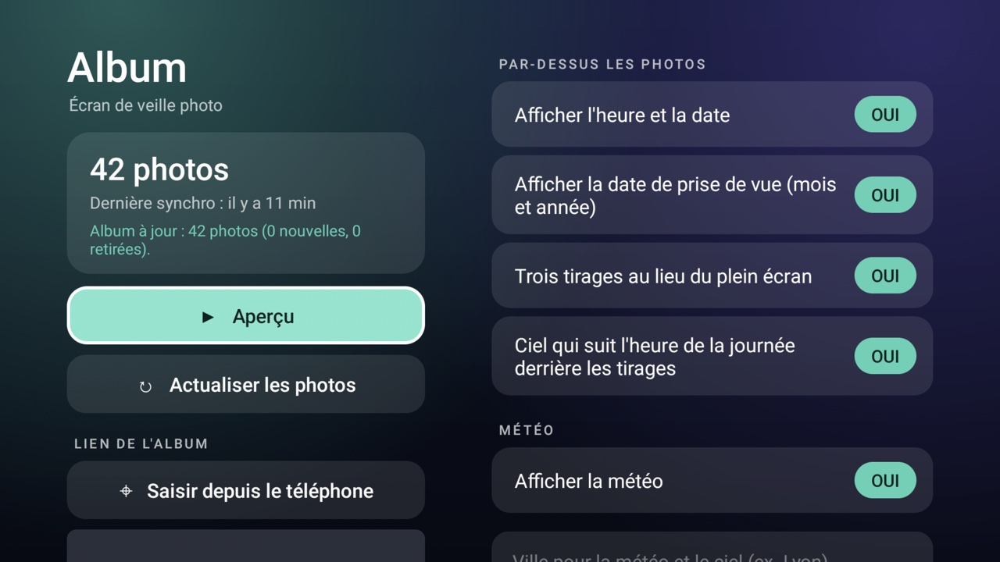

# Album screensaver

A system screensaver (Android's "Daydream") that shows a **shared photo album from a link**: an
[Immich](https://immich.app) shared link or a Google Photos shared album. The TV downloads the pictures itself, keeps
them on its own storage and checks the album again from time to time, so the screensaver follows the album with no
computer involved after the first setup. Its settings app, with a Preview button and a Refresh button, is also a card
on cleanyourtv's Home.

It is the [Photo screensaver](../photo-screensaver/) add-on (zooming slideshow, optional time, photo dates, prints on a
sky and weather) with the album download added, so the same options are here. Pictures from the album and your own
files cannot be mixed: this one shows the album.

Package `com.cleanyourtv.albumdream`. You see it as **Album** in the TV's screensaver settings, as a tile in the app list
and as a **module card** on Home (see [`docs/modules.md`](../../docs/modules.md)); all three open the settings app.

## Albums it understands

| Link | Looks like | Notes |
|---|---|---|
| Immich shared link, with key | `https://photos.example.com/share/KEY` | Pictures only (clips are skipped). Needs an Immich with shared links on; works from 1.x through the current API. A link behind a sub-path (`https://host/immich/share/KEY`) works. |
| Immich shared link, with slug | `https://photos.example.com/s/my-album` | Same as above. |
| Google Photos shared album | `https://photos.app.goo.gl/...` or `https://photos.google.com/share/...` | **Best effort.** Google has no public API for shared albums, so the TV reads the page the link opens and takes the picture addresses in it. If Google changes that page, this stops finding pictures. Only the pictures Google puts in the page are found (a few hundred at most). |

Not supported: a link protected by a password (Immich) and albums that are not shared by link.

The album must be reachable from the TV: a public address, or a server on your network (plain `http://` works for that).

## What happens

1. `setup.sh` gives the TV the link. The TV reads the album's list, downloads each picture as a screen-sized JPEG (Immich
   "preview", about 1440 px; Google at most 1920 x 1080) and saves it.
2. At most **100** pictures are kept, the newest first (those with no date last). A picture already on the TV is not
   downloaded again. A picture that left the album is deleted, but only after the new ones arrived, so a sync that fails
   halfway never leaves the TV with nothing.
3. Every time the screensaver starts, if the last good sync is older than `REFRESH_HOURS` (12 by default), a sync runs in
   the background. New pictures show from the next time the screensaver starts; none is swapped under the viewer.
4. The screensaver starts after the TV has been idle for `IDLE_MINUTES` (it sets `screen_off_timeout`; some TVs go to
   standby instead, then set the time in the TV's own settings).

Immich pictures carry the day they were taken in their file name, so the "when a picture was taken" option works; Google
pictures fall back to the date in the picture's own EXIF data, which Google often removes.

## Install

JDK 17 and Android SDK 34, as for the launcher, and the `tools/venv` from the main README.

```sh
TV_HOST=192.168.1.50 addons/album-screensaver/build-and-install.sh
TV_HOST=192.168.1.50 addons/album-screensaver/setup.sh 'https://photos.example.com/share/KEY'
```

The TV's screen shows the download as it goes. More options, all optional:

```sh
TV_HOST=192.168.1.50 IDLE_MINUTES=10 SECONDS_PER_PICTURE=30 REFRESH_HOURS=6 START=1 \
  addons/album-screensaver/setup.sh 'https://photos.app.goo.gl/AbCdEf'
TV_HOST=192.168.1.50 addons/album-screensaver/setup.sh          # keep the album, change the other settings
TV_HOST=192.168.1.50 addons/album-screensaver/setup.sh --off    # previous screensaver back, album and pictures removed
```

## Settings on the TV



Open the **Album** card on Home (or its tile in the app list, or TV settings > Screensaver > Album > settings). Everything
is reached with the remote. In the app, the left column is the album and its actions, the right column the options.

- **Preview** starts the slideshow at once; Back leaves it. Holding OK or pressing Menu in the slideshow comes back here.
- **Refresh photos** syncs the album now (the screen shows the progress, the count and when the last sync was).
- With **three prints**, a landscape print gets a wider column than a portrait one, and how much wider follows the album:
  from 1.25 times a portrait column when the album is all landscape to 2 times when it is all portrait, so landscape
  photos stay as easy to see as the portraits beside them.

| Setting | What it does |
|---|---|
| Album link | **Enter from your phone** shows a QR code: scan it, paste the link on the page that opens on the phone, send it, and the TV saves it and syncs. Typing on the keyboard works too (its Enter saves and syncs). |
| Time and date | A line along the bottom, moved a little every minute against burn-in. |
| Photo dates | The month and year of the picture. |
| Three prints, sky | The prints layout, and a sky behind it that follows the **real sun**: the dawn and sunset glows fall on the sunrise and sunset worked out for your place and the day (see below), and the night in between stays dark blue. |
| Weather and sky place | The city you type (or, without one, the TV's last known location) is also where the sun is judged from. With neither, the sky guesses mid-latitudes on the TV's time-zone longitude. |
| Weather | The temperature with a plain white line icon (sun, moon, cloud, rain, snow, storm; drawn in code, no colour), updated every 30 minutes. The place is the **city you type** (found with Open-Meteo's geocoding, no key), or, when none is set, the TV's own rough location (rounded to about 1 km; needs the location permission and the TV's location services). |
| Time per picture | 10, 20, 30, 60 or 120 seconds. |
| Start the screensaver after | 1, 2, 5, 10, 15, 30 or 60 minutes without a key press. This sets Android's screen-off timeout, which needs the "modify system settings" permission: `setup.sh` and `build-and-install.sh` grant it over adb (`appops set ... WRITE_SETTINGS allow`). Without it the screen says so. |
| Check the album every | 1, 6, 12, 24 or 72 hours. |

`build-and-install.sh --uninstall` does `--off` and removes the app.

`setup.sh` quotes the link into a shell command on the TV, so it refuses a link with a quote or other characters a web
address never has.

## Permissions

| Permission | Why |
|---|---|
| `INTERNET` | Downloads the album from the server in the link, and the weather and city lookup from Open-Meteo when that option is on. Nothing else is contacted and nothing is sent about you or the TV: the requests carry only the album's own key. It is also what lets the app listen on the local network for the phone page (below). |
| `ACCESS_COARSE_LOCATION` | Only with the weather option on and no city typed: the TV's rough location, rounded to about 1 km, for Open-Meteo. |
| `WRITE_SETTINGS` | Only to change the screen-off timeout (the delay before the screensaver) when you pick one in the settings. Granted over adb; nothing else in system settings is touched. |
| `android:usesCleartextTraffic` | A self-hosted Immich on your own network is often plain `http://`. The app only fetches the address you give it. |

Everything the app writes (the pictures, the link, the status line) is in its own app storage, which `setup.sh --off`
empties. The activity that sets the link, and the provider that `--off` uses, can only be called by the adb shell
(they require `WRITE_SECURE_SETTINGS`), so another app cannot change which album the screensaver shows. No telemetry, no
accounts, no ads.

**Enter from your phone** starts a small web server on the TV's address on your home network, only while that panel is open
(it stops when you close it, leave the screen or the link arrives). Its one page is at an address carrying a random token that
only the QR code shows, so another device on the network cannot send a link without having seen the code. The page is plain
`http` on your network, never reachable from the internet, and a link is only accepted if it is an Immich or Google Photos
album link.

The album link contains the share key, which is what lets anyone open the album: keep it as private as the album. It is
stored on the TV in the app's private storage and appears in your shell history when you run `setup.sh`.

## The sky and the sun

The sky behind the prints is a palette of night blues with warm glows at dawn and sunset. Instead of fixed clock times it uses
the sunrise and sunset of the day for your place, from the sunrise equation (`Solar.java`, checked in the tests against
Open-Meteo's own times for Lyon, Reykjavik, Tokyo and Sydney: within a few minutes), and works in the TV's own clock. The
glows last about 70 minutes around each. It follows the TV's time zone, so the TV's **time zone must be right** (a fixed
`GMT+02:00` instead of a real zone such as Europe/Paris does not follow daylight saving, and the clock and sky are an hour out
for half of the year).

## Limits

- At most 100 pictures, 10 MB each (a screen-sized JPEG is far below that).
- Clips are not shown (Immich videos are skipped); a Google album's videos are skipped too.
- Google Photos reading is best effort, as above.
- Tested on a TCL 55C735 (Google TV 11, device G05): a real Immich 3.2 shared link and a real Google Photos shared album
  (list, download, removal of pictures that left the album), a mock server for the older Immich API path, the settings
  screen with the remote (focus, city lookup, delays), and the screensaver starting by itself after the idle time.
  Immich 3.x lists an album's pictures through a search call instead of the shared link; both are handled.

## Screenshots

`screenshot.jpg` shows the screensaver with five NASA photographs (public domain: aurorae seen from the International Space
Station and the Lagoon Nebula from Hubble) put on the TV by hand instead of an album; `settings.jpg` is the settings app with the
album link hidden.

## Tests

`cd addons/album-screensaver && ./gradlew testReleaseUnitTest`: link parsing, the Immich answer, the Google page, file
names, the column widths, the weather reading and icons, the phone page's form. (Pure Java, no TV needed.)

Based on the [Photo screensaver](../photo-screensaver/) add-on and, through it, Photo Prints by
[@shivamsingh262](https://github.com/shivamsingh262) (#936). The QR code generator (`Qr.java`, `QrView.java`) is from the
[News screensaver](../news-screensaver/) add-on, which follows Project Nayuki's MIT-licensed layout.
